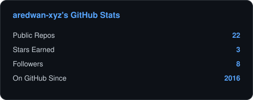
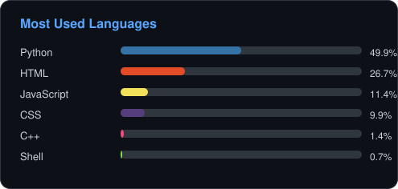

# 🌲 Evergreen Stats

**Generate GitHub profile stat cards as static SVG files.**

Hosted stats-card services render images on a shared server. Rate limits or outages at that
service can affect the images displayed in a profile README.

Evergreen Stats generates the same kind of card, but **inside your own GitHub Action run**, as a
plain SVG file committed straight to your repo. This removes an external rendering server
from the page-load path. Generation still depends on GitHub API access and a successful
Action run; displaying the saved image depends on GitHub's file hosting. Failed generation
can leave an older card visible, so check the workflow timestamp when freshness matters.

<p align="center">
  
  &nbsp;&nbsp;
  
</p>

## Why

| | Third-party render services | Evergreen Stats |
|---|:-:|:-:|
| Where it renders | Their server, every page load | Your Action run, once per schedule |
| Rendering dependency at page load | External rendering server | GitHub's static file hosting |
| Rate limits | Shared across every user of the service | Your own `GITHUB_TOKEN` (5,000 req/hr) |
| Generation dependencies | Rendering service and GitHub API | GitHub API, Actions runner and Python |

This isn't a criticism of those projects — they're popular *because* they're good, and popularity
is exactly what breaks a shared render server. Evergreen Stats sidesteps the problem entirely by
not having one.

## Quickstart

Add a workflow like this one — `.github/workflows/stats.yml`:

```yaml
name: Update stats
on:
  schedule:
    - cron: "0 */6 * * *"   # every 6 hours
  workflow_dispatch:

permissions:
  contents: write

jobs:
  update:
    runs-on: ubuntu-latest
    steps:
      - uses: actions/checkout@v4
      - uses: aredwan-xyz/evergreen-stats@v1
        with:
          user: your-github-username
          out: ./assets
          theme: dark
      - run: |
          git config user.name "github-actions[bot]"
          git config user.email "github-actions[bot]@users.noreply.github.com"
          git add assets/
          git diff --staged --quiet || git commit -m "chore: refresh stat cards [skip ci]"
          git push
```

Then reference the generated files in your profile README:

```markdown


```

That's it — no API keys beyond the `GITHUB_TOKEN` every workflow already gets for free.

## Inputs

| Input | Default | Description |
|---|---|---|
| `user` | *required* | GitHub username to generate cards for |
| `out` | `./assets` | Output directory |
| `theme` | `dark` | `dark` or `light` |
| `bg_color` | — | Override background (hex) |
| `title_color` | — | Override title/accent color (hex) |
| `text_color` | — | Override body text color (hex) |
| `border_color` | — | Override border color (hex) |

## What it generates

- **`stats.svg`** — public repos, stars earned, followers, account age
- **`languages.svg`** — your top 6 languages by bytes, aggregated across owned repos

Both are computed with two GitHub REST API calls per repo (well within the authenticated rate
limit for any normal-sized account) and rendered as hand-written SVG — no headless browser, no
canvas library, no image-rendering service.

## Status

v1. Intentionally minimal and reliable over feature-complete — more card types (streak, activity
graph) are possible next steps. API or workflow failures can leave saved metrics stale; inspect
the Action run before treating a card as current.
Issues and PRs welcome.

## License

MIT
